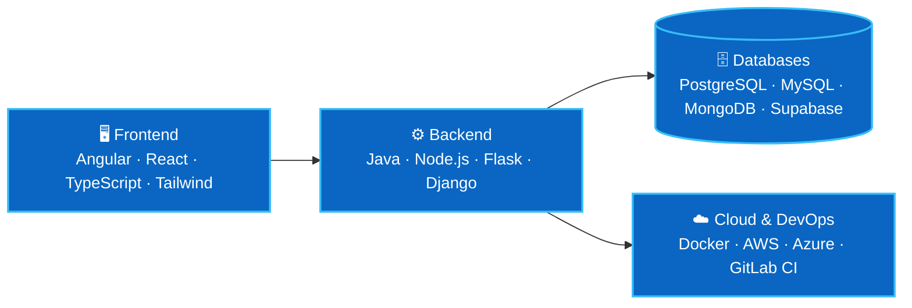
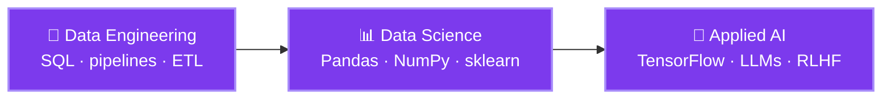

  

### 💼 What I do

- 🏢 **Sopra Steria** (2025 → now) — Full-stack dev on **SAMARAI** for Orange: evolving a 500k-line Java/Angular codebase, architecture, tests, CI/CD
- 🧠 **Outlier** (2023 → 2024) — **RLHF evaluator & LLM trainer**: sharpening model reasoning on code and math
- 💻 **Freelance** (2023 → 2024) — full-stack web apps built end-to-end: React, TypeScript, Tailwind, Supabase
- 🏆 **Pépite** student-entrepreneur — 3rd prize, INSA entrepreneurship program (HomeView)

### 🛠️ Tech stack — how it connects

### 🔬 Data & AI — where I'm headed

Grounded in real work: RLHF training @ Outlier · bank fraud detection (Random Forest, SVM) · data analysis @ INSA

### 📫 Let's connect

  

